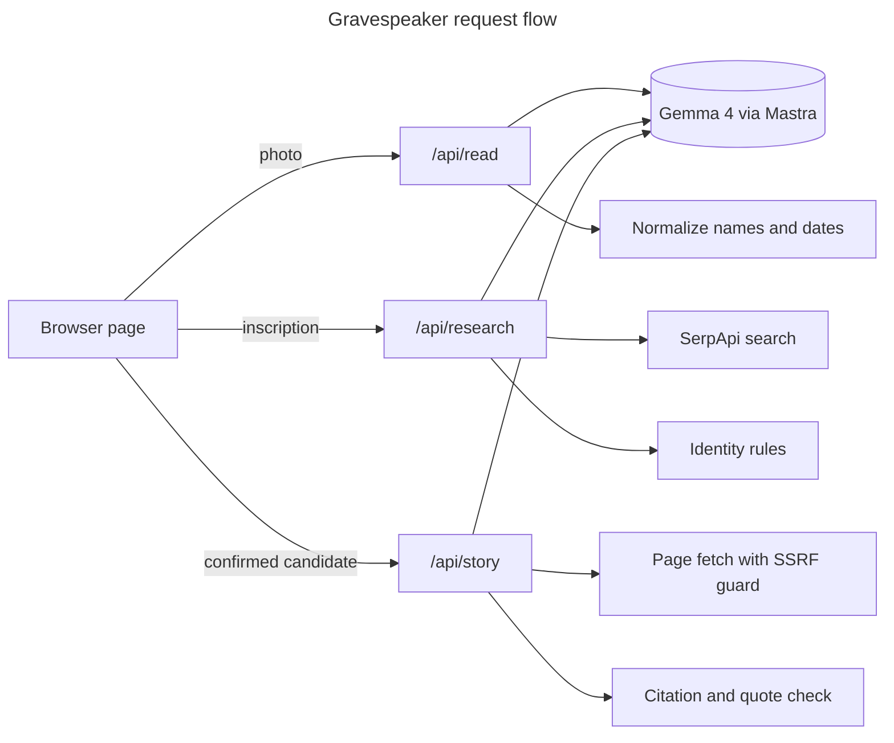

# 🪦 Gravespeaker

<!-- Banner image: add one at static/banner.png and uncomment below -->
<!--  -->

[](https://github.com/anchildress1/gravespeaker/actions/workflows/ci.yml) [](https://sonarcloud.io/project/overview?id=anchildress1_gravespeaker) [](LICENSE)

Photograph a headstone. Discover a life. Hear the story the records left behind.

- [About](#about)
- [Features](#features)
- [Tech Stack](#tech-stack)
- [Architecture](#architecture)
- [Project Structure](#project-structure)
- [Getting Started](#getting-started)
- [Configuration](#configuration)
- [Deploying](#deploying)
- [Security](#security)
- [License](#license)
- [Author](#author)

---

## About

Gravespeaker is a mobile-friendly web app. Upload or snap a photo of a gravestone, confirm what the AI read from the stone, and get a short first-person story built only from public records you can click through and check.

If the records can't establish who the person was, the app says so instead of making something up. Every claim is either cited or clearly marked as AI reconstruction.

Built for Hacktoberfest 2026, Week 4: Ghost in the Machine. The [PRD](docs/PRD.md) has the full scope, schedule and definition of done.

---

## Features

| Step    | What you get                                                                                               |
| ------- | ---------------------------------------------------------------------------------------------------------- |
| Read    | Name and life dates from a photo, shown read-only. Maiden names are split out; unreadable digits stay `?`. |
| Confirm | Candidate people with source links. You always confirm, or pick "none of these".                           |
| Story   | First-person story where each fact links its source, and imagined lines are labelled as such.              |
| Epitaph | When records are missing or thin, a plain account of what the stone itself says. No AI label.              |

---

## Tech Stack

| Layer              | Choice                                          |
| ------------------ | ----------------------------------------------- |
| App                | SvelteKit (Svelte 5, Vite 8), `adapter-node`    |
| Runtime            | Node.js 26.12.1, TypeScript 6 (strict), pnpm 11 |
| AI orchestration   | Mastra (agents and in-memory workflows)         |
| Vision and stories | Gemma 4 26B via the Gemini API (free tier)      |
| Record search      | SerpApi (Google engine)                         |
| Page text          | Readability, linkedom, robots-parser            |
| Hosting            | Google Cloud Run, Secret Manager                |
| Quality            | Vitest, Playwright, ESLint, SonarCloud, CodeQL  |

---

## Architecture

One page drives three stateless endpoints. The browser holds journey state between calls; nothing is stored server-side. Model output never reaches the visitor unchecked: deterministic code owns names, dates, identity rules and citations.



Only two seams exist: model inference (`src/lib/server/inference/`) and record search (`src/lib/server/search/`), one implementation each.

---

## Project Structure

```text
src/
├── env.ts                  # Declares the two API keys for SvelteKit
├── routes/
│   ├── +page.svelte        # The whole journey, one state machine
│   ├── journey.e2e.ts      # Playwright, endpoints mocked
│   └── api/{read,research,story}/+server.ts
└── lib/
    ├── types.ts            # Shared client/server shapes
    ├── epitaph.ts          # Stone-only epitaph, no model
    └── server/             # Never reaches the client bundle
        ├── inference/      # Model seam + Gemma implementation
        ├── search/         # Search seam + SerpApi implementation
        ├── inscription.ts  # Name and date normalization
        ├── identity.ts     # Query, gated-site filter, candidate rules
        ├── pages.ts        # SSRF-guarded fetch, robots, text extraction
        ├── narrative.ts    # Citation and quote grounding
        ├── research.ts     # Mastra workflow: search, group, resolve
        └── story.ts        # Mastra workflow: fetch, tell, ground
benchmarks/                 # Headstone-reading runs and scorer
fixtures/                   # Reviewed headstone photos and answer key
specs/001-mvp-journey/      # Spec, plan and tasks
```

---

## Getting Started

You need:

- [Volta](https://volta.sh) with pnpm support switched on. Volta reads the pinned Node and pnpm versions from `package.json`.
- `actionlint` and `gitleaks`, which the git hooks call.

```bash
export VOLTA_FEATURE_PNPM=1          # add to your shell profile
brew install actionlint gitleaks

make install                          # dependencies + Lefthook git hooks
cp .env.example .env                  # then fill in the keys
make dev
```

### Commands

| Command            | What it does                                                  |
| ------------------ | ------------------------------------------------------------- |
| `make dev`         | Start the dev server                                          |
| `make ai-checks`   | Format check, lint, typecheck, unit tests and build in one go |
| `make test`        | Unit tests with coverage                                      |
| `make e2e`         | Playwright tests on a mobile viewport                         |
| `make secret-scan` | gitleaks over the working tree                                |
| `make deploy`      | Ship to Cloud Run                                             |
| `make clean`       | Remove build output                                           |

The Lefthook hooks run format, lint, actionlint and gitleaks on every commit; commitlint on every commit message; and typecheck, unit and e2e tests before every push.

---

## Configuration

| Variable          | Used for                           |
| ----------------- | ---------------------------------- |
| `GEMINI_API_KEY`  | Gemma 4 vision and narrative calls |
| `SERPAPI_API_KEY` | Public-record search               |

Locally, these go in `.env`, which is gitignored. In production, Cloud Run injects them from Secret Manager (see [Deploying](#deploying)).

---

## Deploying

Production runs as one Cloud Run service in the `anchildress1` GCP project:

- **Runtime identity:** the `gravespeaker-run` service account.
- **Secrets:** namespaced per app and mapped to the variables above.

| Secret Manager name            | Env var           |
| ------------------------------ | ----------------- |
| `GRAVESPEAKER_GEMINI_API_KEY`  | `GEMINI_API_KEY`  |
| `GRAVESPEAKER_SERPAPI_API_KEY` | `SERPAPI_API_KEY` |

Both secrets and the service account already exist, and the account can read both secrets. `make deploy` builds the image with Cloud Build and deploys it.

To rebuild the setup from scratch, or to add a new secret, run the matching commands from the repo root:

```bash
SA=gravespeaker-run@anchildress1.iam.gserviceaccount.com
gcloud iam service-accounts create gravespeaker-run --project anchildress1

# Repeat per key; the value comes from .env and never touches the terminal.
grep '^GEMINI_API_KEY=' .env | cut -d= -f2- | tr -d '\n' \
  | gcloud secrets create GRAVESPEAKER_GEMINI_API_KEY --data-file=- --project anchildress1
gcloud secrets add-iam-policy-binding GRAVESPEAKER_GEMINI_API_KEY \
  --member "serviceAccount:$SA" --role roles/secretmanager.secretAccessor --project anchildress1
```

Secret Manager bills per secret, so add one only when production can't run without it.

---

## Security

Design requirements from the [PRD](docs/PRD.md) that every feature must keep:

- API keys stay on the server. The browser never talks to Gemini or SerpApi directly.
- Uploaded photos and fetched page text are processed in memory and never stored.
- Facts must trace to a source: a citation that isn't a candidate source, or a quote not found in it, is dropped.

Already in place:

- Page fetching blocks loopback, private, link-local (cloud metadata) and CGNAT addresses, re-checks every redirect hop, and honors `robots.txt`.
- Paywalled genealogy sites are filtered out of search results.
- Secrets are never shared between apps in the GCP project.
- Every GitHub Action is pinned to a commit SHA, and Dependabot proposes updates after a 7-day cooldown.
- gitleaks runs locally before every commit and again in CI.

---

## License

Released under the [Polyform Shield License 1.0.0](LICENSE). It's source-available, not open source, so read the license before you build a paid SaaS on top of it.

- **You can:** use it, fork it, learn from it, run it at your day job, hand it to a client.
- **You can't:** sell it, rebrand it, host it as a paid SaaS, or otherwise make money from it without explicit written permission.
- **Public forks:** include the LICENSE file and credit the original work.

---

## Author

Ashley Childress · [@anchildress1](https://github.com/anchildress1)
