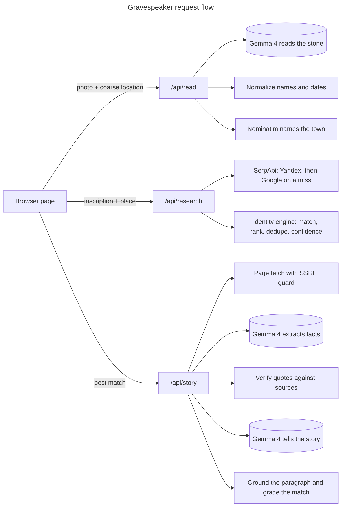

<div align="center">

# 🪦 Gravespeaker

[](https://sonarcloud.io/project/overview?id=anchildress1_gravespeaker) [](LICENSE)

</div>

<p align="center">
	
</p>

Photograph a headstone. Discover a life. Hear the story the records left behind.

- [About](#about)
- [Features](#features)
- [Tech Stack](#tech-stack)
- [Architecture](#architecture)
- [Project Structure](#project-structure)
- [Getting Started](#getting-started)
- [Configuration](#configuration)
- [Deploying](#deploying)
- [Benchmarks](#benchmarks)
- [Security](#security)
- [License](#license)
- [Author](#author)

---

## About

Gravespeaker is a mobile-friendly web app. Upload or snap a photo of a gravestone, check what the AI read from the stone, and hear a short theatrical story built only from facts checked against public records you can click through.

The story is openly fiction, labelled "Story generated with AI", but it states only facts that appear in a cited source. If the records can't establish who the person was, the app says so instead of making something up.

Built for Hacktoberfest 2026, Week 4: Ghost in the Machine. The [PRD](docs/PRD.md) has the full scope, schedule and definition of done.

---

## Features

| Step     | What you get                                                                                                                                            |
| -------- | ------------------------------------------------------------------------------------------------------------------------------------------------------- |
| Read     | Name and life dates from a photo, shown read-only. Maiden names are split out; unreadable digits stay `?`.                                              |
| Place    | Where they lived or died: a town carved on the stone, or your coarse location (or the photo's GPS) named by OpenStreetMap. Used only to narrow search.  |
| Research | Public records searched on Google and Yandex, then matched on name, birth year and death year. A missing date never rules a result out.                 |
| Match    | The best-ranked person is picked for you, no confirmation step. A name-only match is used only when a fetched page proves the stone's dates.            |
| Story    | One theatrical first-person paragraph labelled "Story generated with AI", written from verified facts, with its sources listed. Built to be read aloud. |
| Grade    | One confidence grade for the person picked: high (name and every date match), medium (name and one date), low (name only). Deterministic, no model.     |
| Epitaph  | When records are missing or thin, a plain account of what the stone itself says. No AI label.                                                           |

---

## Tech Stack

| Layer              | Choice                                                                                       |
| ------------------ | -------------------------------------------------------------------------------------------- |
| App                | SvelteKit (Svelte 5, Vite 8), `adapter-node`                                                 |
| Runtime            | Node.js 26.12.1, TypeScript 6 (strict), pnpm 11                                              |
| AI orchestration   | Mastra (agents and in-memory workflows), Zod                                                 |
| Vision and stories | Gemma 4 26B via the Gemini API (free tier): reads the stone, extracts facts, tells the story |
| Record search      | SerpApi (Google and Yandex engines)                                                          |
| Place names        | OpenStreetMap Nominatim reverse geocoding, ExifReader for photo GPS                          |
| Page text          | Readability, linkedom, robots-parser, undici (pins the checked DNS answer)                   |
| Hosting            | Google Cloud Run, Secret Manager                                                             |
| CI                 | Depot CI for `ci` and release-please, GitHub Actions for CodeQL                              |
| Quality            | Vitest, Playwright, ESLint, SonarCloud, CodeQL, Lefthook, commitlint                         |

---

## Architecture

One page drives three stateless endpoints. The browser holds journey state between calls; nothing is stored server-side. Model output never reaches the visitor unchecked: deterministic code owns names, dates, identity rules and citations. Research uses no model at all.



Research is a Mastra loop that runs one search at a time through three phases: name and dates, then name, dates and town, then name and town. Each phase is asked first without death keywords, which finds pages about the life, then with `(obituary OR grave OR cemetery)`, which finds obituaries the plain query ranks lower. Name and town alone runs last, because it mostly finds namesakes; a stone with no readable year has only the name to search on. Each phase asks Yandex first and Google only when Yandex finds nobody with a matching date, and the loop stops at the first dated match. Google now hides most result links behind its own redirect, relative or absolute; those links are never kept as pages, and the provider follows every one (a free request, no SerpApi credit) to the page it leads to. A redirect that lands back on Google, such as a captcha, is dropped. An engine still failing after Mastra's retries counts as a miss; both engines failing in a row is an outage, reported as an error rather than as nobody found. A page found by several searches keeps every snippet it was shown with. Results are interleaved by rank across searches, each engine ranked on its own, so one search's crowd can't push the others' best results past the five-source cap. Matches rank by keys matched (name, birth year, death year), then by how many results agree, then by the order results arrive in. A result whose stated year disagrees with the stone is dropped. A name-only result is kept only when it states no year against the stone anywhere in its snippet; a middle initial or generational suffix (Jr., Sr., II, III) the stone rules out marks that mention as a namesake and only a mention marked as the stone's own then counts; a match on an initial alone, or a page titled with another person's dates, is someone else. The page tells the top one. A name-only match counts only when one of its fetched pages states at least one of the stone's dates for that name; otherwise the story rests on the stone.

Only two seams exist: model inference (`src/lib/server/inference/`) and record search (`src/lib/server/search/`), one implementation each.

---

## Project Structure

```text
src/
├── env.ts                  # Declares the two API keys for SvelteKit
├── routes/
│   ├── +page.svelte        # The whole journey, one state machine
│   ├── journey.e2e.ts      # Playwright, endpoints mocked
│   └── api/{read,research,story}/+server.ts
└── lib/
    ├── types.ts            # Shared client/server shapes
    ├── epitaph.ts          # Stone-only epitaph, no model
    ├── locate.ts           # Coarse browser location, 8 s patience
    └── server/             # Never reaches the client bundle
        ├── inference/      # Model seam + Gemma implementation (read, extract, tell)
        ├── search/         # Search seam + SerpApi (engines, URL dedupe)
        │   └── sites.ts    # Gated-site and people-directory filter
        ├── inscription.ts  # Name and date normalization
        ├── query.ts        # Research queries in the order tried
        ├── identity.ts     # Deterministic matching, ranking and page grades
        ├── photo-location.ts # GPS from the photo's EXIF
        ├── geocode.ts      # Nominatim reverse lookup: ~1 km, 1 request a second
        ├── pages.ts        # SSRF-guarded fetch, robots, text extraction
        ├── narrative.ts    # Quote verification and story grounding
        ├── research.ts     # Mastra workflow: phased search loop, Yandex then Google
        ├── story.ts        # Mastra workflow: fetch, extract, tell, ground, grade
        ├── http.ts         # Error mapping for the endpoints
        └── env.ts          # Reads the API keys on use
.depot/workflows/           # Depot CI: ci and release-please
benchmarks/                 # Reading, search and end-to-end runs, scorer and saved results
benchmarks/evals/           # Live story evals: Mastra scorers with a Gemini judge
benchmarks/research.eval.ts # Research replayed from saved SerpApi responses (RECORD=1 records)
fixtures/serp/              # Saved raw SerpApi responses, key removed
docs/                       # PRD and benchmark write-ups
fixtures/                   # Reviewed headstone photos and answer key
specs/001-mvp-journey/      # Spec, plan and tasks
```

---

## Getting Started

You need:

- [Volta](https://volta.sh) with pnpm support switched on. Volta reads the pinned Node and pnpm versions from `package.json`.
- `actionlint` and `gitleaks`, which the git hooks call.

```bash
export VOLTA_FEATURE_PNPM=1          # add to your shell profile
brew install actionlint gitleaks

make install                          # dependencies + Lefthook git hooks
cp .env.example .env                  # then fill in the keys
pnpm exec playwright install chromium # once, for make e2e
make dev
```

### Commands

| Command            | What it does                                                  |
| ------------------ | ------------------------------------------------------------- |
| `make dev`         | Start the dev server                                          |
| `make ai-checks`   | Format check, lint, typecheck, unit tests and build in one go |
| `make test`        | Unit tests with coverage                                      |
| `make e2e`         | Playwright tests on a mobile viewport                         |
| `make eval`        | Live story evals against Gemma, judged by Gemini; never in CI |
| `make secret-scan` | gitleaks over the working tree                                |
| `make deploy`      | Ship to Cloud Run                                             |
| `make clean`       | Remove build output                                           |

The Lefthook hooks run format, lint, actionlint and gitleaks on every commit; commitlint on every commit message; and typecheck, unit and e2e tests before every push.

### CI

Pull requests run `ci` on Depot CI (`.depot/workflows`). CodeQL stays on GitHub Actions, because it looks up an Actions run that Depot runs don't have. The GitHub copies of `ci.yml` and `release-please.yml` are disabled, not deleted, so GitHub-hosted CI can be switched back on with `gh workflow enable`.

---

## Configuration

| Variable          | Used for                                              |
| ----------------- | ----------------------------------------------------- |
| `GEMINI_API_KEY`  | Gemma 4 calls: reading the stone, facts and the story |
| `SERPAPI_API_KEY` | Public-record search                                  |

Locally, these go in `.env`, which is gitignored. In production, Cloud Run injects them from Secret Manager (see [Deploying](#deploying)).

Each search is one SerpApi credit on one engine. A research request runs 1 to 12, fewer when an early search finds the person or no town is known. The Starter plan allows 1,000 a month. Gemma and the eval judge run on the free Gemini API tier.

Place names come from the public OpenStreetMap Nominatim service. Its usage policy allows one request a second with an identifying User-Agent, so a lookup queued more than 2 s is skipped and the search runs without the town. Coordinates are rounded to about a kilometre before they leave the server.

---

## Deploying

Production runs as one Cloud Run service in the `anchildress1` GCP project:

- **Runtime identity:** the `gravespeaker-run` service account.
- **Secrets:** namespaced per app and mapped to the variables above.

| Secret Manager name            | Env var           |
| ------------------------------ | ----------------- |
| `GRAVESPEAKER_GEMINI_API_KEY`  | `GEMINI_API_KEY`  |
| `GRAVESPEAKER_SERPAPI_API_KEY` | `SERPAPI_API_KEY` |

Both secrets and the service account already exist, and the account can read both secrets. `make deploy` builds the image with Cloud Build and deploys it.

To rebuild the setup from scratch, or to add a new secret, run the matching commands from the repo root:

```bash
SA=gravespeaker-run@anchildress1.iam.gserviceaccount.com
gcloud iam service-accounts create gravespeaker-run --project anchildress1

# Repeat per key; the value comes from .env and never touches the terminal.
grep '^GEMINI_API_KEY=' .env | cut -d= -f2- | tr -d '\n' \
  | gcloud secrets create GRAVESPEAKER_GEMINI_API_KEY --data-file=- --project anchildress1
gcloud secrets add-iam-policy-binding GRAVESPEAKER_GEMINI_API_KEY \
  --member "serviceAccount:$SA" --role roles/secretmanager.secretAccessor --project anchildress1
```

Secret Manager bills per secret, so add one only when production can't run without it.

---

## Benchmarks

Each run is saved under `benchmarks/results/` and never overwritten.

- **Reading:** run 11 got 63 of 64 fields right across 21 reviewed stones, at a 3.8 s median. See [the OCR write-up](docs/benchmarks/ocr-smoke-test.md).
- **Search:** `search-1.json` compares five engines on 10 stones. Google and Yandex found 31 of the 35 sources kept, so those two remain.
- **Research:** `research.eval.ts` replays saved SerpApi responses and saves `research-N.json`; `record-stories.ts` freezes story inputs from the newest run without searching. See [the search write-up](docs/benchmarks/search.md).
- **End to end:** `pipeline-1.json` ran read, research and story on 21 stones, with a 24 s median per stone and 12 of 16 stories told. Low confidence dominates, because snippets rarely carry dates.

---

## Security

Design requirements from the [PRD](docs/PRD.md) that every feature must keep:

- API keys stay on the server. The browser never talks to Gemini or SerpApi directly.
- Uploaded photos and fetched page text are processed in memory and never stored.
- The visitor's location is coarse, rounded to about a kilometre before the town lookup, and never stored.
- Facts must trace to a source: a quote not found verbatim in a cited source is dropped, and so is one that names a survivor.

Already in place:

- Page fetching blocks loopback, private, link-local (cloud metadata), CGNAT, multicast and NAT64, 6to4 and Teredo addresses. It pins DNS to the checked answer, re-checks every redirect hop, and honors `robots.txt`, treating an unreachable one as disallow-all.
- Two people are never merged: results with contradicting dates become separate candidates, and a name-only match is told only when a fetched page proves the stone's dates.
- The story drops sentences that add a number, a name or a negation the facts don't give.
- Paywalled genealogy sites are filtered out of search results.
- Secrets are never shared between apps in the GCP project.
- Every GitHub Action is pinned to a commit SHA, and Dependabot proposes updates after a 7-day cooldown.
- gitleaks runs locally before every commit and again in CI.

Known limits, accepted for the MVP:

- `/api/story` trusts the candidate the browser sends. The later fix is a signed candidate or re-running research.
- The story check compares numbers, names and negations, not the meaning of free prose.

---

## License

Released under the [Polyform Shield License 1.0.0](LICENSE). It's source-available, not open source, so read the license before you build a paid SaaS on top of it.

- **You can:** use it, fork it, learn from it, run it at your day job, hand it to a client.
- **You can't:** sell it, rebrand it, host it as a paid SaaS, or otherwise make money from it without explicit written permission.
- **Public forks:** include the LICENSE file and credit the original work.

---

## Author

Ashley Childress · [@anchildress1](https://github.com/anchildress1)
