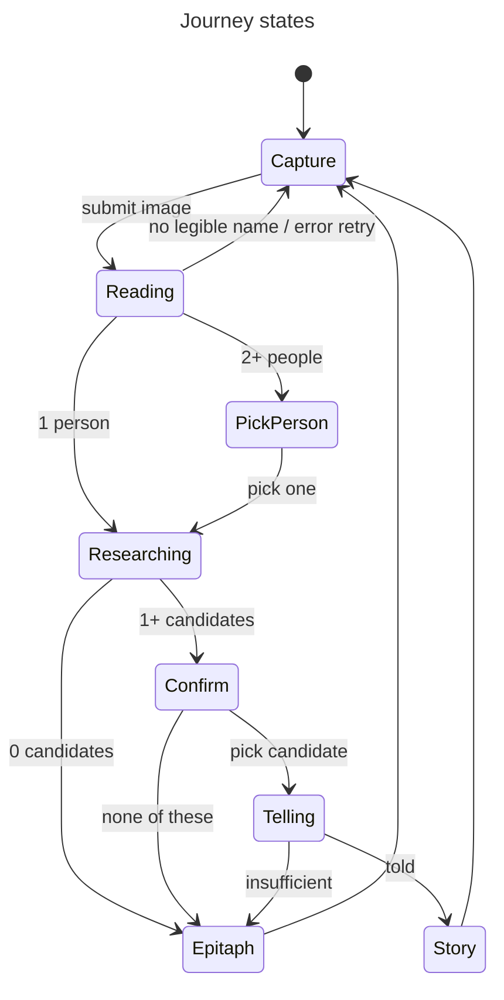

# Data Model: Gravespeaker MVP Journey

No persistence. Every entity lives for one request, or in browser memory between requests.

## PartialDate

String matching `^[0-9?]{4}(-[0-9?]{2}-[0-9?]{2})?$`: `YYYY` or `YYYY-MM-DD`, each digit `0-9` or `?`. `null` = not on the stone.

- Any other model output → `null`.
- A year match treats `?` as a wildcard: `18?8` matches `1818` and `1848`.

## Inscription

One person read from the stone, after normalization (`inscription.ts`).

| Field        | Type                | Rule                                                                                   |
| ------------ | ------------------- | -------------------------------------------------------------------------------------- |
| `carvedName` | string              | Model output as read; display only.                                                    |
| `name`       | string              | Honorifics (`Mr`, `Mrs`, `Miss`, `Dr`) dropped, `née …` removed, whitespace collapsed. |
| `maidenName` | string \| null      | Surname after `née`/`nee`, else `null`.                                                |
| `born`       | PartialDate \| null |                                                                                        |
| `died`       | PartialDate \| null |                                                                                        |

- A name with no Unicode letter is rejected, so the person is dropped.
- A read returns `Inscription[]`. An empty array means no legible name.

## SourceRecord

A search hit (`search/` seam output, after the gated-domain filter).

| Field     | Type   | Rule                                              |
| --------- | ------ | ------------------------------------------------- |
| `id`      | string | Stable within one research response (`s1`…`s10`). |
| `url`     | string | `http(s)` only.                                   |
| `title`   | string |                                                   |
| `site`    | string | Hostname, used for display and the deny-list.     |
| `snippet` | string | Used for matching; shown as a short preview only. |

## Candidate

The person the identity engine matched records to (`identity.ts` output). Usually one per response. Results whose stated dates contradict each other are different people and become separate candidates, at most three.

| Field        | Type                          | Rule                                                                                          |
| ------------ | ----------------------------- | --------------------------------------------------------------------------------------------- |
| `name`       | string                        | The Inscription's name.                                                                       |
| `born`       | PartialDate \| null           | The year a matched result states, else null.                                                  |
| `died`       | PartialDate \| null           | The year a matched result states, else null; never conflicts with the stone.                  |
| `confidence` | `'high' \| 'medium' \| 'low'` | `high`: every key the stone offers matches (at least 2). `medium`: 2+ keys. `low`: name only. |
| `sources`    | SourceRecord[]                | Length 1-5. Matched results, ordered by matching keys, then record-like pages.                |

## Story

A union:

- `{ status: 'told', paragraph: string, sources: SourceRecord[] }`: one spoken first-person paragraph. `sources` holds only the sources of facts the paragraph uses.
- `{ status: 'insufficient' }`: the client then shows the Epitaph.

- Facts (`claim`, `sourceId`, `quote`) are server-only and never sent to the client. A fact survives only if its quote is found verbatim in its cited source's text.
- Sentences that add a number, a proper noun or a negation the verified facts do not give are dropped before the paragraph is returned.

## Epitaph

Client-side, built by `epitaph(inscription, today)` in `src/lib/epitaph.ts` (pure, deterministic, no model call).

| Sentence                                                                                    | Shown when                                                                                              |
| ------------------------------------------------------------------------------------------- | ------------------------------------------------------------------------------------------------------- |
| `My name was {name}.`                                                                       | always (a read always has a name)                                                                       |
| `I was born on {Month D, YYYY}.` / `I was born in {YYYY}.`                                  | `born` known, no `?`                                                                                    |
| `I died on {Month D, YYYY}.` / `I died in {YYYY}.`                                          | `died` known, no `?`                                                                                    |
| `I've been here {n} years.` / `I've been here 1 year.` / `I've been here less than a year.` | `died` known, no `?`; `n` = whole years from `died` to `today` (year-only `died` → `today.year - YYYY`) |

- Source: the headstone. Not labelled AI-generated.
- Shown with a note: `No public record was confirmed` (none of these), `No public records were found` (0 candidates), or `The records hold nothing beyond the stone` (insufficient).

## Client journey state

