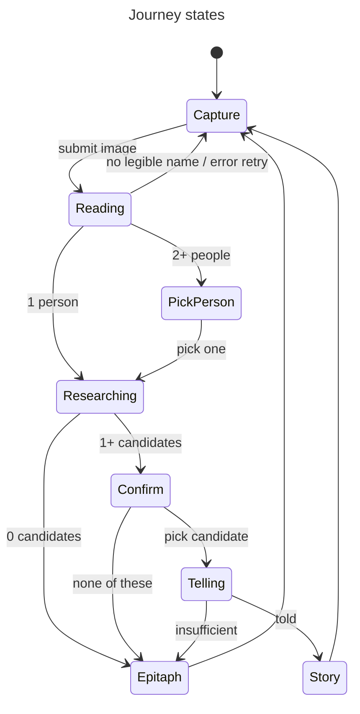

# Data Model: Gravespeaker MVP Journey

No persistence. Every entity lives for one request, or in browser memory between requests.

## PartialDate

String matching `^[0-9?]{4}(-[0-9?]{2}-[0-9?]{2})?$`: `YYYY` or `YYYY-MM-DD`, each digit `0-9` or `?`. `null` = not on the stone.

- Any other model output → `null`.
- A year match treats `?` as a wildcard: `18?8` matches `1818` and `1848`.

## Inscription

One person read from the stone, after normalization (`inscription.ts`).

| Field        | Type                | Rule                                                                                   |
| ------------ | ------------------- | -------------------------------------------------------------------------------------- |
| `carvedName` | string              | Model output as read; display only.                                                    |
| `name`       | string              | Honorifics (`Mr`, `Mrs`, `Miss`, `Dr`) dropped, `née …` removed, whitespace collapsed. |
| `maidenName` | string \| null      | Surname after `née`/`nee`, else `null`.                                                |
| `born`       | PartialDate \| null |                                                                                        |
| `died`       | PartialDate \| null |                                                                                        |

- A name with no Unicode letter is rejected, so the person is dropped.
- A read returns `Inscription[]`. An empty array means no legible name.

## SourceRecord

A search hit (`search/` seam output, after the gated-domain filter).

| Field     | Type   | Rule                                              |
| --------- | ------ | ------------------------------------------------- |
| `id`      | string | Stable within one research response (`s1`…`s10`). |
| `url`     | string | `http(s)` only.                                   |
| `title`   | string |                                                   |
| `site`    | string | Hostname, used for display and the deny-list.     |
| `snippet` | string | Used for matching; shown as a short preview only. |

## Candidate

One hypothesized person (`identity.ts` output).

| Field     | Type                | Rule                                                   |
| --------- | ------------------- | ------------------------------------------------------ |
| `name`    | string              |                                                        |
| `born`    | PartialDate \| null |                                                        |
| `died`    | PartialDate \| null | Known years must not conflict with the Inscription.    |
| `place`   | string \| null      |                                                        |
| `sources` | SourceRecord[]      | Length ≥ 1. No SourceRecord appears in two candidates. |

- Maximum of 5 per response, ordered by the number of Inscription fields matched.

## StorySentence

| Field       | Type                         | Rule                                                              |
| ----------- | ---------------------------- | ----------------------------------------------------------------- |
| `text`      | string                       |                                                                   |
| `kind`      | `'fact' \| 'reconstruction'` |                                                                   |
| `sourceIds` | string[]                     | `fact`: ≥ 1, all in `Candidate.sources`. `reconstruction`: empty. |

- Server-only fields `claim` and `quote` are used for validation and never sent to the client.
- A `fact` survives only if its `quote` is found in one cited source's text.

## Story

A union:

- `{ status: 'told', sentences: StorySentence[], sources: SourceRecord[] }`, which requires at least one surviving fact with `claim: 'other'`.
- `{ status: 'insufficient' }` — the client then shows the Epitaph.

## Epitaph

Client-side, built by `epitaph(inscription, today)` in `src/lib/epitaph.ts` (pure, deterministic, no model call).

| Sentence                                                                                    | Shown when                                                                                              |
| ------------------------------------------------------------------------------------------- | ------------------------------------------------------------------------------------------------------- |
| `My name was {name}.`                                                                       | always (a read always has a name)                                                                       |
| `I was born on {Month D, YYYY}.` / `I was born in {YYYY}.`                                  | `born` known, no `?`                                                                                    |
| `I died on {Month D, YYYY}.` / `I died in {YYYY}.`                                          | `died` known, no `?`                                                                                    |
| `I've been here {n} years.` / `I've been here 1 year.` / `I've been here less than a year.` | `died` known, no `?`; `n` = whole years from `died` to `today` (year-only `died` → `today.year - YYYY`) |

- Source: the headstone. Not labelled AI-generated.
- Shown with a note: `No public record was confirmed` (none of these), `No public records were found` (0 candidates), or `The records hold nothing beyond the stone` (insufficient).

## Client journey state

